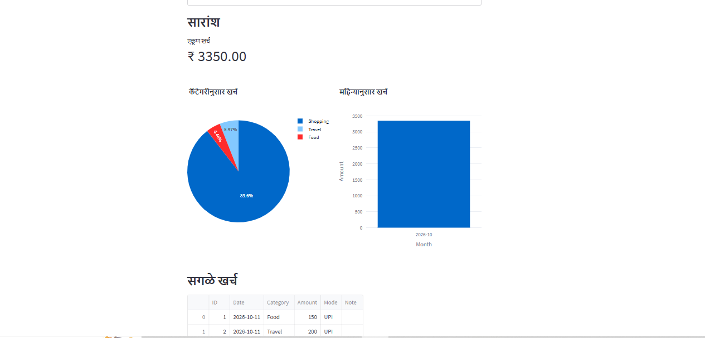

# Personal Expenses Tracker

A simple web app to log daily expenses and see where your money goes, by category and by month.

## Problem
Many students and young professionals lose track of small daily expenses (UPI payments, food, travel, subscriptions). Notes record the spending but don't give totals, trends or insights.

## Solution
This app lets you add expenses in seconds and automatically shows spending summaries and charts, so you can spot overspending early.

## Features

- Add expenses with date, category, amount, payment mode and note
- Total spending summary
- Category-wise pie chart
- Month-wise bar chart
- View all expenses in a table
- Delete entries

## Tech Stack
Python, SQLite, Pandas, Plotly, Streamlit

## How to Run
1. Install dependencies: pip install -r requirements.txt
2. Start the app: streamlit run app.py
3. Open http://localhost:8501 in your browser

## Future Improvements
- Budget limits with alerts
- CSV import from bank/UPI statements
- Automatic expense categorization
- Next-month spending prediction